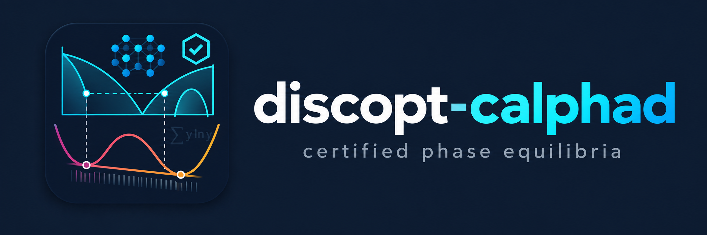

<div align="center">



[](https://github.com/jkitchin/discopt-calphad/actions/workflows/tests.yml)
[](https://kitchingroup.cheme.cmu.edu/discopt-calphad/)

</div>

# discopt-calphad

Certified CALPHAD phase equilibrium as a discopt plugin (`import discopt.calphad`).

**Method.** A restricted multiphase Gibbs-energy minimization over the active
composition sets is solved locally. Its elemental-balance multipliers are the
chemical potentials μ. For every phase, discopt's global solver then minimizes
the tangent-plane distance Ψ(y) = G(y) − μ·A(y):

- a negative upper bound adds a new composition set (this is how miscibility
  gaps are found);
- a lower bound ≥ −ε for every phase certifies the result to within ε·RT
  per mole of formula units.

**Status.** Pre-alpha.

- **MVP 1:** a binary regular solution with a miscibility gap.
- **MVP 2:** binary systems with several phases: Redlich–Kister solutions,
  line compounds, T-dependent energies, and phase appearance and
  disappearance.
- **MVP 3:** TDB import and export into a symbolic `ThermoDatabase` (SymPy
  expressions with named functions kept), and binary phase models built from
  it. Unsupported models (order–disorder, ionic) raise with the reason.
  Magnetic phases (Inden–Hillert–Jarl) are solved, but not yet certified
  globally.
- **MVP 4:** compound-energy-formalism phases (`CEFPhase`: several sublattices,
  endmembers, binary/reciprocal/ternary interactions, vacancies) in any number
  of elements, checked against pycalphad. Pricing stops as soon as its answer
  is decided: LB ≥ −ε or UB < −ε. Open: when a two-sublattice phase is
  *active*, its bound stalls near −1e-4, so the result is
  `GLOBAL_SEARCH_INCOMPLETE`.
- **Fitting (issue #2):** weighted least squares of TDB parameters (symbolic
  T-forms) to thermochemical, activity and phase-equilibrium data, including
  one-sided phase-boundary points (driving-force residuals) and multi-sublattice
  phases. ESPEI JSON datasets are read directly. Results include the
  covariance, a fitted TDB, and certified equilibrium checks. Fitted to the real
  Cu–Mg data curated for ESPEI (238 one-sided boundary points plus
  thermochemistry), the liquid and compound parameters come out close to the
  NIMS assessment, and the diagram follows the liquidus and eutectic data.
  The FCC interaction differs: the DFT mixing enthalpies pull the Cu-rich
  solvus wider than the measured one (`examples/cumg_espei_fit.py`).
- **Order–disorder stand-ins (issue #14):** `ordering.stand_in` rewrites a
  partitioned phase (L1₂, B2) as a plain phase the solver supports. For Ni–Al
  both are exact (pycalphad agrees to 1e-10 J/mol); magnetism and vacancies on
  substitutional sites are dropped and listed.
- **Data from ASE calculators (issue #5, phase 1):** `discopt.calphad.mlip`
  turns any ASE calculator (a machine-learned potential such as UMA or MACE,
  EAM, EMT) into fitting data: formation enthalpies of compounds and CEF
  endmembers, and SQS mixing enthalpies (icet), with σ from their spread,
  a source label on every observation, and a check that flags structures
  that leave their prototype. The certificate covers the fitted model, not the
  calculator (`docs/mlip.md`).
- **Pricing modes:** `equilibrium(certify="final")` (the default) uses cheap
  local pricing to generate composition sets and global pricing once, at the
  converged μ. `certify="none"` skips the global step (`STABILITY_SEARCHED`), and
  `res.certify()` adds it later. `certify="every"` prices globally in every
  iteration.

See `docs/architecture.md` for the design and
`docs/symbolic-diagrams-fitting.md` for the planned symbolic model, phase
diagram, and fitting layers.

## Related projects

- **[pycalphad](https://pycalphad.org)** is an open-source Python library for
  CALPHAD models and equilibria. It reads TDB databases, supports a broad range
  of models (magnetic, order–disorder, ionic liquids and more), and is mature
  and widely used. We use it as a test oracle for our Gibbs energies and
  equilibria; the package itself never imports it.
- **[ESPEI](https://espei.org)** builds on pycalphad. It generates CALPHAD
  parameters from data and quantifies their uncertainty with Bayesian (MCMC)
  sampling.
- **[OpenCalphad](https://www.opencalphad.com)** is an open-source Fortran
  equilibrium software package.
- **Thermo-Calc, FactSage and Pandat** are the commercial standards. They come
  with assessed multicomponent databases.

For real alloy work today, use those tools. discopt-calphad is a pre-alpha
research code. It covers far fewer models, and it is much slower. On the same
TDB files (`benchmarks/pycalphad_comparison.py`, pycalphad 0.11.2, Apple M4 Pro),
a warm pycalphad point takes about 5 ms. An uncertified solve here
(`certify="none"`) takes 20–80 ms, and a certified one takes 6–65 s. For a
19-point composition sweep, pycalphad is about 50–90× faster than
`certify="none"`. Where both codes find the same phases, GM agrees to within
0.02 J/mol and μ to within 0.1 J/mol.

## Why another CALPHAD code

A CALPHAD equilibrium is a nonconvex minimization. Gibbs energy curves have
several wells (miscibility gaps, ordered phases) and many phases compete. The
established codes find the global minimum well in practice, typically by
sampling each phase's composition space on a grid and then refining locally.
But the answer carries no proof: nothing shows that a composition between the
grid points, or a narrow gap, lowers G further. You usually cannot tell a
missed phase from a correct result.

discopt-calphad asks whether the equilibrium can come with a **certificate**.
The certificate is a rigorous lower bound, from global optimization, showing
that no composition of any candidate phase lowers G by more than ε.

## What is different here

- **Certified or explicitly not.** Every result carries a certificate level and
  a bound on G_found − G_global. When the global search cannot close the gap in
  time, the result says so (`GLOBAL_SEARCH_INCOMPLETE`, with the bound it did
  reach) instead of returning a plausible answer silently.
- **Grid-free correctness.** Grids and heuristics may supply starting points,
  but correctness never depends on them. It rests on the global pricing bound
  (discopt spatial branch-and-bound, plus interval bounds at the composition
  boundary).
- **Symbolic models.** Databases and phase models are SymPy expressions that
  keep TDB function names. You can inspect, differentiate, and edit them, and
  write them back to TDB. Fitting uses exact symbolic T-derivatives for H, S
  and Cp.
- **Part of an optimization language.** The equilibrium subproblems are discopt
  models. So the same machinery can later go inside larger problems:
  constrained fitting, alloy design, and checking a fitted parameter set for
  spurious phases.
- **Fitting tied to certification.** Fitted databases are checked with
  certified equilibria at the data conditions. The planned global-consistency
  step certifies that a fit predicts no phase the data rule out
  (`docs/symbolic-diagrams-fitting.md` §5).

```python
from discopt.calphad import RegularSolution, equilibrium

phase = RegularSolution("LIQ", omega=3.0)   # G/RT, omega = Omega/RT
res = equilibrium(phase, x=0.5, eps=1e-5)
print(res.certificate, [cs.x for cs in res.composition_sets], res.mu)

fast = equilibrium(phase, x=0.5, certify="none")   # local pricing only: STABILITY_SEARCHED
fast.certify()                                     # global pricing at the stored μ, later
```

```python
from discopt.calphad import BinarySolution, StoichiometricPhase, TPoly, equilibrium

# energies in J/mol; TPoly(a, b, c, d, e) = a + bT + cT ln T + dT^2 + e/T
liq = BinarySolution("LIQUID", g=(TPoly(10000, -10), TPoly(15000, -10)), L=(-5000,))
fcc = BinarySolution("FCC_A1", L=(20000, 3000))
ab = StoichiometricPhase("AB", ("A", "B"), (0.5, 0.5), g=-5000)
res = equilibrium([liq, fcc, ab], x=0.3, T=1000, eps=1e-5)
print(res.summary())   # FCC_A1 + AB, CERTIFIED_TO_TOLERANCE
```

```python
from discopt.calphad import databases, equilibrium

db = databases.load("alzn_mey")        # fetched once from its pinned URL, hash-checked
print(db.applicability(("AL", "ZN")))        # which phases can be modelled, and why not
phases = db.phase_models(("AL", "ZN"))
print(phases["LIQUID"].L[0].expr())          # 10465.5 - 3.39259*T  (symbolic, SymPy)
db.add_tdb("PARAMETER G(LIQUID,AL,ZN;1) 298.15 -500; 6000 N !")   # edit in TDB syntax
res = equilibrium(list(db.phase_models(("AL", "ZN")).values()), x=0.5, T=500)
print(db.to_tdb()[:200])
```

```python
from discopt.calphad import databases, equilibrium

db = databases.load("cumg_nims")
phases = db.phase_models(("CU", "MG"))
cu2mg = phases["CU2MG"]                      # CEFPhase (CU,MG)2(CU,MG)1
print(cu2mg.gibbs_expr())                    # SymPy in y0_CU, y1_MG, ..., T, R
res = equilibrium(list(phases.values()), x=0.75, T=700)
print(res.summary())                         # FCC_A1 + CU2MG
```

```python
from discopt.calphad import databases
from discopt.calphad.fit import Dataset, fit

db = databases.load("alzn_mey")
data = Dataset.from_json("examples/data/alzn_synthetic.json")   # HM_MIX, SM_MIX, ACR, ZPF
res = fit(db, data, ("AL", "ZN"), {"L(FCC_A1,AL,ZN;0)": "a + b*T", "L(LIQUID,AL,ZN;0)": "a + b*T"})
print(res.summary())                         # values ± σ, residuals by data kind
open("alzn_fit.tdb", "w").write(res.to_tdb())
```

## Databases

The package ships no TDB files. It ships a registry,
`src/discopt/calphad/databases.json`, of published databases. Each entry has a
URL pinned to one commit, the file's SHA-256, the assessment it comes from, and
a list of the phases this package cannot model yet in each binary.
`databases.fetch(name)` downloads a file once into the user cache and checks the
hash. A copy that pycalphad installs is used without downloading.

```python
from discopt.calphad import databases

[e.name for e in databases.find(["AL", "FE"])]       # files that form Al–Fe
databases.find(["AL", "FE"], complete=True)          # [] -- every one has an order–disorder phase
databases.get("alzn_mey").reference                  # 'S. an Mey, Z. Metallkd. 84 (1993) 451–455; ...'
```

Where to find more TDB files:
- [TDBDB](https://avdwgroup.engin.brown.edu/) indexes the TDB files published with
  the CALPHAD literature;
- [NIMS CPDDB](https://cpddb.nims.go.jp/) has several hundred assessments, and needs
  a free login;
- [NIST](https://www.nist.gov/programs-projects/calphad-data-informatics) publishes
  assessments in its Materials Data Repository.

Any of these files can be read with `ThermoDatabase.from_tdb(path)`. To add one
to the registry, write its hand-written fields into `databases.json` and run
`uv run python tools/refresh_registry.py`.

## Development

```bash
uv sync
uv run pytest -m "not slow"                      # what CI runs; drop -m for the slow solves too
uv run ruff check . && uv run ruff format --check .
uv sync --group docs && uv run mkdocs build --strict   # site: https://kitchingroup.cheme.cmu.edu/discopt-calphad/
uv run python examples/regular_solution_gap.py   # writes examples/regular_solution_gap.png
uv run python examples/alzn_tdb.py               # TDB -> certified Al–Zn equilibria
uv run python examples/cumg_cef.py               # CEF Laves phase in Cu–Mg
uv run python examples/alzn_fit.py               # fit Al–Zn parameters to data
uv run python benchmarks/simplex_bound_study.py  # pricing formulations for 2-sublattice phases
```

pycalphad is a dev dependency used only as a test oracle; the package never imports it.

### Agent skill

`skills/discopt-calphad/SKILL.md` teaches coding agents (Claude Code and others)
to use the package: workflows with runnable snippets, certificate levels,
conventions and pitfalls. `reference/phase-protocol.md` describes the interface
for writing a custom phase model. `tests/test_skill.py` runs every snippet.
To use it with Claude Code, copy or link the directory into `~/.claude/skills/`.

### Release checklist

1. `uv run pytest` passes, including the slow tests (or run the `tests`
   workflow with `slow: true`).
2. `uv run ruff check . && uv run ruff format --check .`
3. `uv run mkdocs build --strict`
4. The database registry is current: `uv run python tools/refresh_registry.py`
   leaves `databases.json` unchanged.
5. **The agent skill is current.** `skills/discopt-calphad/SKILL.md` covers
   every new or changed workflow, convention and unsupported model, and
   `tests/test_skill.py` passes.
6. Bump `version` in `pyproject.toml` and `__version__`, then tag.
